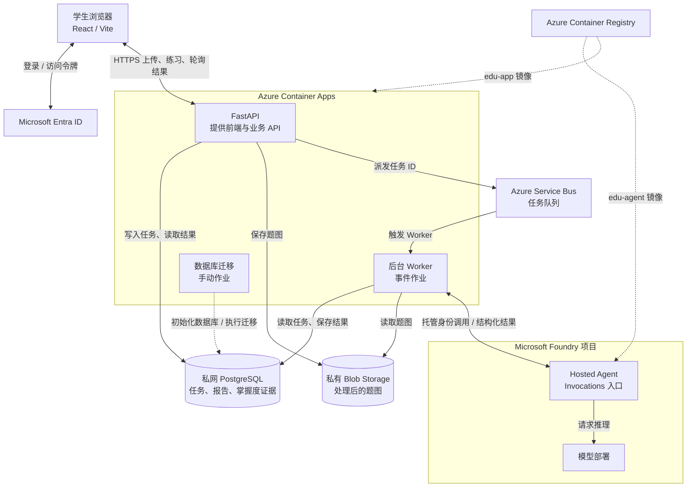
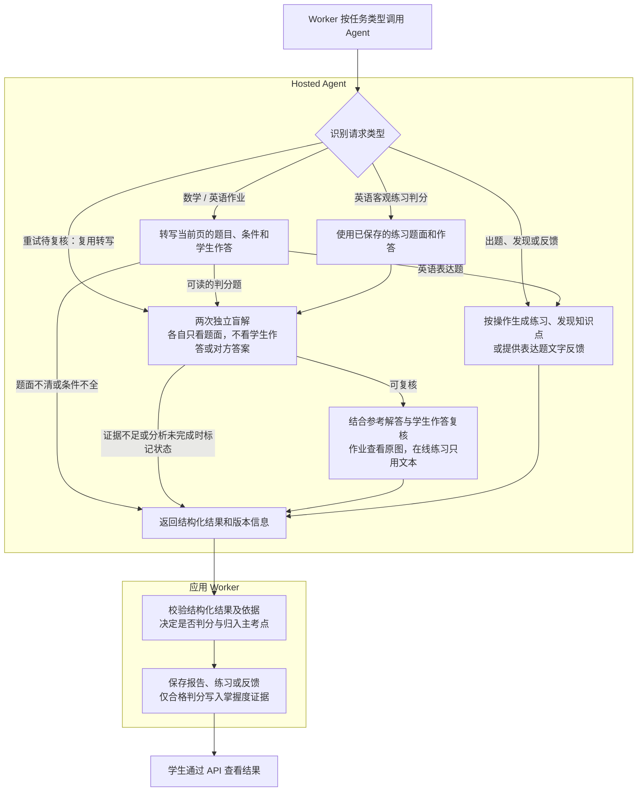

# 作业回路

面向初一学生的数学和英语学习助手。上传作业或试卷图片，查看逐题批改和知识点掌握情况，再按薄弱项练习。数学保留确定性规则练习；英语词汇、语法和阅读可做客观判分，写作和听说文本只提供文字建议。

[组件架构图](#组件架构图) · [Agent 工作流程图](#agent-工作流程图) · [本地运行](#本地运行) · [批改与掌握度](#批改与掌握度) · [Azure 部署与运维](infra/README.md)

## 组件与数据流

### 组件架构图

下图为 Azure 合成测试环境。实线表示运行时交互，虚线表示镜像发布或数据库迁移。



Agent 不直接访问数据库、Blob 或队列；Worker 只在需要时读取并传入题图。API 验证访问令牌并按所有者限制读取。网络、日志和发布权限见 [Azure 运维手册](infra/README.md#环境与权限)。

| 组件 | 本地合成演示 | Azure 合成测试环境 |
| --- | --- | --- |
| React / Vite 前端、FastAPI 接口 | 同一个 API 进程提供页面和接口 | 一个 Azure Container App 提供页面和接口 |
| 后台 Worker | 轮询本地数据库 | Container Apps 事件作业，由 Service Bus 队列触发 |
| 数据库和题图 | SQLite 和 `.edu-ai/` 下的私有图片目录 | 私网 PostgreSQL Flexible Server 和私有 Blob Storage |
| 批改、出题与反馈 | 固定合成样例；不调用模型 | Microsoft Foundry 项目、Hosted Agent 和支持图像及结构化输出的模型 |
| 登录、镜像与运维 | 两个本地演示账号，不需要 Azure | Microsoft Entra ID、托管身份、Azure Container Registry、VNet / 私有 DNS、Azure Monitor |

每次可上传 1–4 页单帧 JPG/JPEG 或 PNG，每张最多 8 MB、6400 万像素，宽高均至少 120 像素。服务端校正方向、清除元数据并按比例缩小，保存为最长边不超过 1800 像素、不超过 500 KB 的 JPEG，不改动本地原图。

## 本地运行

准备 Python 3.12 或更高版本、[uv](https://docs.astral.sh/uv/)、Node.js 22.12 或更高版本。在仓库根目录运行：

```bash
uv sync --locked
npm --prefix apps/web ci
npm --prefix apps/web run build
EDU_MODE=local .venv/bin/python -m edu_app migrate
EDU_MODE=local .venv/bin/python -m edu_app serve --with-worker
```

打开 <http://127.0.0.1:8000>，点「试用合成样卷」，或切换「英语」后点「试用英语合成样卷」。也可在右上角切换两个演示账号；作业、练习和掌握度各自独立。本地默认写入 `.edu-ai/`，使用 SQLite 和私有图片目录，不需要 Azure 账号或模型密钥。**默认替身只分析自带合成样卷**；自行上传的图片不会得到模拟分数。英语练习和文字建议也是明确标记的固定合成样例，不代表真实模型效果。请勿上传真实学生数据。

已有本地数据时，升级代码后先运行 `migrate` 再启动。连接真实 Agent 不是演示的必要条件；本地 API 只接受回环地址的 `EDU_AGENT_URL`，开启真实 AI 批改前必须配置该地址。

## 批改与掌握度

### Agent 工作流程图

下图以启用全 AI 批改的数学、英语作业和英语客观练习为主，标出 Agent 与 Worker 的分工。



数学复核可用受限的 SymPy 工具核验计算，Worker 会复验声明的计算；英语在线练习由 Worker 额外比对发布时的参考答案。已完成页可恢复；对「待复核」题的重试复用原图和已有转写，不重新批改整份作业。

| 场景 | 批改与反馈 |
| --- | --- |
| 数学作业 | 全 AI 模式下，Agent 先转写题目和作答，再由两次独立盲解和原图复核给出判分。数学可用受限的 SymPy 工具核验计算或等价关系。关闭全 AI 时使用规则与开放复核的混合模式，开放复核不计入掌握度。 |
| 数学在线练习 | 规则题的生成、判分和诊断仍使用原规则；作答前不展示答案，看过提示的作答不计入掌握度。 |
| 英语客观题 | 全 AI 模式下，作业采用双盲解题和原图复核；在线练习提交后异步判分，与出题时的参考核对，完成前隐藏答案。单选不判部分正确；填空可接受符合题意的等价表达。关闭全 AI 时沿用旧版答案匹配。 |
| 英语表达题 | 写作、听力文本预习和口语草稿只给文字建议，不打分、不计掌握度，也不评估真实听力或发音。 |

AI 判分是学习参考，不是教师标准答案。正确、部分正确、错误按 `2/1/0` 计入最多一个有依据的主考点；留白、无法判定、待复核或无法可靠归因的题不计入。每个考点取最近 10 道不同题的首次有效作答，少于 3 道显示「证据不足」，规则和 AI 样本分别标记。数学作业和新版英语作业可从已完成页恢复；报告出现「重试待复核」时，可复核未完成的题，不需重复上传。重拍后转写内容不一致的题不保证去重。

数学和英语的学习数据分开保存。上传也会触发独立的知识点发现任务，识别出的新概念标为「待教师整理」；发现失败不影响批改。目录只共享通用名称、章节和说明，不共享学生的原图、作答或反馈。Azure 上只有 API 访问令牌带 `Teacher` 或 `Admin` 角色的用户可维护目录；通过新增知识点生成的参考练习不计分。

## Azure 部署

先核对[环境与权限](infra/README.md#环境与权限)，再按[首次部署](infra/README.md#首次部署)或[已有环境升级](infra/README.md#已有环境的分阶段应用升级)操作。当前仓库使用 **Azure CLI + Bicep + ACR 隔离构建 + Foundry SDK**，无需另建 azd 项目。

代码与模板默认关闭数学和英语全 AI 开关；现有 North Central US 合成测试环境的两项开关已开启。两者只影响新作业，英语还影响新建客观练习；历史记录不回填。参见[功能开关与回滚](infra/README.md#功能开关与回滚)。

## 项目结构与验证

[`apps/web`](apps/web) 是学生端；[`services/app`](services/app) 包含 API、Worker 和数据库迁移；[`services/foundry-agent`](services/foundry-agent) 包含 Hosted Agent 和本地替身；[`packages/domain`](packages/domain) 包含共享契约、图片预处理及判分校验；[`infra`](infra) 包含 Bicep、镜像定义和发布脚本。

```bash
uv sync --locked --all-extras
.venv/bin/python -m pytest
npm --prefix apps/web ci
npm --prefix apps/web run build
npm --prefix apps/web exec -- playwright install chromium
npm --prefix apps/web run test:e2e
```

Python 测试默认使用临时 SQLite；设置 `EDU_TEST_DATABASE_URL` 为专用测试 PostgreSQL 的 `postgresql+psycopg://…` 地址可同时检查两个后端（需有权限创建和删除临时 schema）。浏览器测试自行启动使用临时数据库的本地应用。使用已安装的 Chrome 时，可跳过下载 Chromium 并设置 `PLAYWRIGHT_CHROMIUM_CHANNEL=chrome`。

真实模型覆盖率和判分一致率须用人工标注的合成样本另行评估。评估素材、历史结果与执行限制见[合成评估记录](infra/README.md#合成评估记录)。
